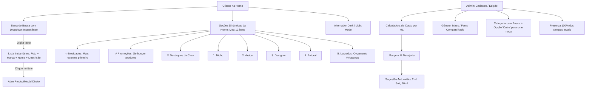

# Plano de Implementação: Filtros Avançados, Busca com Autocomplete, Seções Dinâmicas, Modo Dark e Precificação Inteligente

> **Documento de Especificação Técnica e Roteiro de Execução**  
> **Data:** 20 de Outubro de 2026  
> **Projeto:** OFFGLASS SCENT (Next.js 16 + React 19 + Supabase + Tailwind CSS v4)  

---

## 1. Visão Geral e Arquitetura da Solução

O objetivo desta evolução é transformar a experiência da **OFFGLASS SCENT** em uma vitrine de alto padrão com navegação fluida, busca instantânea e conversão acelerada tanto para decants fracionados quanto para frascos lacrados, além de equipar a administração com um precificador automático com base em custo por ML e markup.

---

## 2. Estrutura Oficial de Categorias e Ordem das Seções

### 2.1 Ordem Oficial das Categorias na Home
As seções de categoria seguirão rigorosamente esta sequência prioritária:
1. 💎 **Nicho**
2. 🕌 **Árabe** (Árabes)
3. 🏛️ **Designer**
4. 🎨 **Autoral**
5. 📦 **Lacrados** *(Fluxo especial de orçamento)*

> **Regra Obrigatória:** Se uma dessas categorias (ou qualquer seção) tiver **0 produtos cadastrados**, ela **NÃO é apresentada** na Home. Apenas categorias com pelo menos 1 perfume ativo aparecem.

### 2.2 Tratamento Especial da Categoria "Lacrados"
A categoria **Lacrados** atende à venda de frascos originais fechados (e não apenas decants):
- **No Card do Produto:** Em vez de exibir a seleção de 2ml/5ml/10ml, o card exibe o selo **"Frasco Lacrado"** com botão de ação direta **"Solicitar Orçamento"** com ícone do WhatsApp.
- **No Modal de Detalhes:** O botão principal de ação converte para **"Solicitar Orçamento no WhatsApp"**, disparando mensagem personalizada para o WhatsApp oficial com o nome do perfume, marca e solicitação de cotação do frasco lacrado.

### 2.3 Seções Comerciais Complementares (se houver itens)
- ⚡ **Promoções Imperdíveis** (produtos com desconto percentual ativo).
- ✨ **Novidades / Recém Chegados** (ordem estrita de cadastro: os últimos adicionados aparecem primeiro).
- 🌟 **Destaques Selecionados** (perfumes marcados com `destaque = true`).

---

## 3. Detalhamento dos Módulos a Implementar

### Módulo 1: Banco de Dados & Migração Supabase
Arquivo: `supabase/04_migration_filtros_precificacao_categorias.sql`
- **Novas colunas na tabela `produtos`:**
  - `genero text default 'compartilhado' check (genero in ('masculino', 'feminino', 'compartilhado'))`
  - `destaque boolean default false`
  - `custo_frasco numeric(10,2) default 0`
  - `volume_frasco_ml numeric(10,2) default 100`
  - `margem_lucro_pct numeric(10,2) default 100`
  - `criado_em timestamptz default now()`
- **Seed e atualização das categorias oficiais:**
  - Garantir no banco as categorias padrão: `nicho` (Nicho), `arabe` (Árabe), `designer` (Designer), `autoral` (Autoral), `lacrados` (Lacrados).
- Compatibilidade total: nenhuma coluna existente será removida ou alterada de forma destrutiva.

---

### Módulo 2: Admin — Precificador Inteligente & Seletor de Categoria com Busca
Arquivo: `components/admin/ProductForm.tsx`
> **Importante:** Todos os campos existentes (marca, nome, galeria de fotos com upload e ordenação de capa, descrição curta, descrição completa, acordes coloridos, notas de topo/coração/fundo, preços e promoção) são **preservados integralmente**.

- **A. Calculadora Financeira em Tempo Real:**
  - Campo: **Custo total do perfume (frasco lacrado)** (ex: R$ 550,00)
  - Campo: **Quantidade total em ML do frasco** (ex: 100ml, 50ml, 75ml, 125ml)
  - Badge automático: **Custo por ML = R$ X,XX / ml**
  - Campo: **Margem de lucro desejada (%)** (ex: 120%, 150%, 200%) com atalhos rápidos
  - Fórmula dos Decants com custo de insumos (frasco spray vidro + etiqueta = R$ 3,50):
    - 2ml sugerido = `(custo_por_ml * 2 + 3.00) * (1 + margem/100)`
    - 5ml sugerido = `(custo_por_ml * 5 + 3.50) * (1 + margem/100)`
    - 10ml sugerido = `(custo_por_ml * 10 + 4.50) * (1 + margem/100)`
  - Botão **"Aplicar Preços Sugeridos"**: preenche os inputs de preço de 2ml, 5ml e 10ml instantaneamente, permitindo ao lojista fazer qualquer ajuste fino manual.

- **B. Seleção de Categoria com Busca e Opção "(Outro)":**
  - Campo de seleção pesquisável (Combobox): o lojista digita para filtrar as categorias existentes.
  - Opção no final da lista: **"+ Outro (Digitar nova categoria)"**.
  - Ao selecionar "(Outro)", expande um campo de texto para digitar o nome da nova categoria, cadastrando-a dinamicamente tanto no produto quanto na tabela `categorias`.

- **C. Seleção de Gênero:**
  - Seletor em botões estilo toggle: **[Masculino | Feminino | Compartilhado]**.

- **D. Checkbox Destaque:**
  - Marcar se o perfume deve aparecer na vitrine de **Destaques** da Home.

---

### Módulo 3: Barra de Pesquisa com Autocomplete Instantâneo
Arquivo: `components/catalog/SearchBar.tsx` e integração em `CatalogApp.tsx`
- **Comportamento da Busca Instantânea:**
  - Conforme o usuário digita no campo de busca (a partir de 1 caractere):
    - Abre um **painel suspenso flutuante (dropdown de vidro/glass)** com resultados instantâneos.
    - Cada item exibe:
      - 🖼️ Miniatura da foto do perfume
      - 🏷️ Nome do perfume
      - 🏛️ Marca
      - 📝 Breve descrição (1 a 2 linhas)
    - **Clique no item:** Abre diretamente o `ProductModal` do perfume selecionado, permitindo que o cliente veja todas as notas e compre sem precisar trocar de página.
  - Se o cliente pressionar `Enter` ou clicar em "Ver todos os resultados da busca", a grade da página é filtrada exibindo todos os resultados correspondentes.
  - Botão "X" para limpar a busca instantaneamente.

---

### Módulo 4: Seções da Home (Até 12 itens + "Ver Mais" + Ocultar Vazias)
Arquivo: `components/catalog/CatalogApp.tsx` e `components/catalog/CategorySection.tsx`
- **Ordem de Exibição na Home:**
  1. ⚡ **Promoções Especiais** *(se houver itens em promo)*
  2. ✨ **Novidades** *(ordenados pelos mais recentes primeiro)*
  3. 🌟 **Destaques da Casa** *(se houver itens destacados)*
  4. 💎 **Nicho** *(se houver itens)*
  5. 🕌 **Árabe** *(se houver itens)*
  6. 🏛️ **Designer** *(se houver itens)*
  7. 🎨 **Autoral** *(se houver itens)*
  8. 📦 **Lacrados** *(se houver itens - com botão direto de orçamento no WhatsApp)*
  9. Outras categorias criadas pelo lojista *(se houver itens)*
- **Regras de Visualização:**
  - Cada seção apresenta **até 12 perfumes**.
  - Se a seção tiver mais de 12 perfumes: botão elegante **"Ver mais (+X fragrâncias) →"**, que aplica o filtro correspondente e exibe a lista completa.
  - Se a seção tiver 0 perfumes: **não é renderizada**.

---

### Módulo 5: Modo Dark (Tema Escuro de Luxo) & Logo Transparente
Arquivos: `app/globals.css`, `app/layout.tsx`, `components/ui/ThemeToggle.tsx`
- **Paleta Dark Mode de Alta Perfumaria:**
  - Fundo: gradiente preto ônix mineral (`#0D100F` a `#151917`).
  - Cards e Vidro: `rgba(24, 30, 28, 0.72)` com borda sutil dourada/translúcida.
  - Tipografia: Off-white cremoso (`#F5F3EF`) de alto contraste.
  - Acentos: Dourado fosco e Verde Menta/Esmeralda.
- **Alternador Sol/Lua:**
  - Botão discreto no cabeçalho ao lado do carrinho.
  - Salva a preferência no `localStorage`.
  - Script no `<head>` que aplica a classe `.dark` imediatamente para **evitar piscar de tela branca (FOUC)**.
- **Logo Transparente (Canva):**
  - O cliente exportará no Canva o PNG com fundo transparente.
  - No código: remoção de `mix-blend-multiply` e adaptação inteligente via CSS (`dark:brightness-0 dark:invert` ou suporte para `/logo-dark.png`) para manter o logo legível tanto no fundo claro quanto no escuro.

---

## 4. Roteiro Passo a Passo de Execução

### Fase 1: Banco de Dados e Modelagem
- [ ] Criar `supabase/04_migration_filtros_precificacao_categorias.sql` com novas colunas (`genero`, `destaque`, `custo_frasco`, `volume_frasco_ml`, `margem_lucro_pct`, `criado_em`) e categorias padrão.
- [ ] Atualizar `types/index.ts` com as tipagens estendidas.

### Fase 2: Admin com Precificador e Categoria Pesquisável
- [ ] Implementar a Calculadora de Custo/ML e Precificação Sugerida no `ProductForm.tsx`.
- [ ] Implementar o seletor de Categoria com barra de pesquisa e opção `(Outro)` com input de texto.
- [ ] Implementar a seleção de Gênero (Masculino/Feminino/Compartilhado) e checkbox Destaque.
- [ ] Atualizar a API `app/api/admin/produtos/route.ts` para salvar os novos dados.

### Fase 3: Modo Dark e Logo Transparente
- [ ] Configurar tokens e classes `.dark` em `app/globals.css`.
- [ ] Criar o componente `ThemeToggle.tsx` e script anti-flash no `layout.tsx`.
- [ ] Ajustar exibição do logo transparente nos dois temas.

### Fase 4: Barra de Busca com Dropdown Instantâneo
- [ ] Desenvolver `SearchBar.tsx` com painel suspenso de resultados ao digitar (miniatura, nome, marca, descrição).
- [ ] Ligar o clique do resultado diretamente à abertura do `ProductModal`.
- [ ] Adicionar filtros de ordenação (Novidades, Menor Preço, Maior Preço, Mais Vendidos, PROMO).

### Fase 5: Seções da Home e Categoria "Lacrados"
- [ ] Criar o componente `CategorySection.tsx` com limite de 12 itens e botão "Ver mais".
- [ ] Montar a sequência: Novidades -> Promoções -> Destaques -> Nicho -> Árabe -> Designer -> Autoral -> Lacrados.
- [ ] Configurar a regra especial da seção **Lacrados**: card com botão de orçamento no WhatsApp e mensagem pronta.
- [ ] Aplicar a regra estrita de não renderizar seções vazias.
