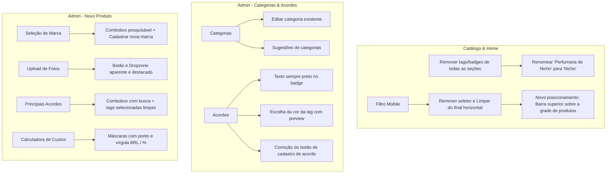

# Plano de Implementação: Novas Funções do Catálogo e Painel Admin

> **Documento de Especificação Técnica e Roteiro de Execução**  
> **Data:** 20 de Outubro de 2026  
> **Projeto:** OFFGLASS SCENT (Next.js 16 + React 19 + Supabase + Tailwind CSS v4)  
> **Arquivo do Plano:** `docs/plans/2026-10-20-novas-funcoes-admin-e-filtros.md`  

---

## 1. Visão Geral e Arquitetura

Este plano atende às solicitações de aprimoramento da interface do catálogo (home e versão mobile) e de evolução do painel administrativo (cadastro de produtos, categorias e acordes).



---

## 2. Escopo Detalhado das Alterações

### 2.1 Catálogo & Home
1. **Remoção de Tags das Seções:**
   - **Novidades:** Remover tag `"Novos"`.
   - **Nicho:** Alterar título de `"Perfumaria de Nicho"` para apenas `"Nicho"` e remover tag `"Exclusivo"`.
   - **Designer:** Alterar título de `"Designers"` para `"Designer"` e remover tag `"Maison"`.
   - **Todas as Categorias:** Nenhuma seção de categoria na Home exibirá badges/tags (Promoções, Destaques, Árabe, Autoral, Lacrados e personalizadas sem tags).
2. **Filtro de Ordenação e Limpeza no Mobile:**
   - Remover o `<select>` de ordenação (`relevancia`, `novidades`, `mais_vendidos`, `menor_preco`, `maior_preco`) e o botão `Limpar` do final da linha deslizante de filtros no mobile.
   - Posicionar a ordenação e limpeza em local dedicado e acessível no mobile: diretamente acima da listagem de produtos (`isFilteredView`), ao lado da contagem de resultados, em uma barra de ferramentas com botão/dropdown limpo e botão de limpar filtros ativos.

### 2.2 Admin — Categorias
1. **Edição de Categorias Cadastradas:**
   - Permitir que a administradora altere o nome (`label`) de qualquer categoria já cadastrada via botão "Editar" na listagem.
   - Suporte na API (`app/api/admin/categorias/route.ts`) para atualização segura sem corromper vínculos de produtos.
   - **Sugestões de edições:** Exibir pílulas de sugestões rápidas recomendadas para perfumaria (ex: *Nicho, Designer, Árabe, Autoral, Lacrados, Edição Limitada, Colecionador, Vintage*).

### 2.3 Admin — Acordes
1. **Tipografia:** Texto do badge olfativo sempre na cor preta (`#000` / `#1b1f1d`), garantindo legibilidade absoluta sobre qualquer tonalidade de cor de fundo.
2. **Cor da Tag:** Seletor de cor aprimorado com paleta de sugestões rápidas em tons pastel/elegantes e pré-visualização em tempo real da tag com texto preto.
3. **Botão em Novo Acorde:** Correção do botão de adicionar acorde (`type="button"`, ícone de adição, estados de foco/hover e feedback de carregamento).

### 2.4 Admin — Cadastro de Produtos (`ProductForm.tsx`)
1. **Seleção de Marca:**
   - Substituir o datalist simples por um Combobox pesquisável com o mesmo padrão visual de categorias.
   - Opção `+ Outro (Cadastrar nova marca)` que abre campo de digitação inline para criar uma marca inédita no ato.
2. **Botão de Upload de Arquivos Aparente:**
   - Substituir o input nativo apagado por uma área de upload (Dropzone) de alto contraste visual com ícone de nuvem/upload, texto explicativo claro ("Clique para selecionar fotos do dispositivo ou arraste aqui") e suporte a múltiplos arquivos.
3. **Seleção de Principais Acordes:**
   - Eliminar a nuvem de tags espalhadas.
   - Implementar Combobox pesquisável: o usuário pesquisa o acorde pelo nome, clica para adicionar e os acordes selecionados aparecem em lista ordenada de tags com botão de remoção rápida `✕`.
   - Opção rápida para cadastrar novo acorde sem sair do formulário.
4. **Calculadora de Custo e Precificação com Máscara Ponto e Vírgula:**
   - Campo **Custo do Frasco**: máscara monetária brasileira automática (`R$ 550,00` ou digitação livre de `550,50` / `1.200,00`).
   - Campo **Margem de Lucro**: máscara percentual com suporte a decimais com vírgula (`120,5%` ou `150%`).
   - Campos de **Preço dos Decants (2ml, 5ml, 10ml)**: digitação formatada com centavos em vírgula e milhar em ponto.

---

## 3. Roteiro de Tarefas Passo a Passo

```markdown
### Tarefa 1: Catálogo — Remoção de Tags das Seções e Ajuste dos Nomes
**Arquivos:**
- Modificar: `components/catalog/CategorySection.tsx`
- Modificar: `components/catalog/CatalogApp.tsx`

**Ações:**
1. Em `CategorySection.tsx`, desativar a renderização do bloco `{badge && (...)}` no cabeçalho da seção.
2. Em `CatalogApp.tsx`:
   - Seção Novidades: remover `badge="Novos"`.
   - Seção Nicho: mudar título para `"Nicho"` e remover `badge="Exclusivo"`.
   - Seção Designers: mudar título para `"Designer"` e remover `badge="Maison"`.
   - Remover badges de Promoções (`"Ofertas"`), Destaques (`"Curadoria"`), Árabe (`"Oriental"`), Autoral (`"Autoral"`) e Lacrados (`"Frascos Completos"`).
3. Teste manual: abrir a Home e verificar que todos os títulos aparecem limpos, sem qualquer pílula amarela ou tag adicional.
```

```markdown
### Tarefa 2: Catálogo — Reposicionamento do Filtro de Ordenação e Limpeza no Mobile
**Arquivos:**
- Modificar: `components/catalog/Filters.tsx`
- Modificar: `components/catalog/CatalogApp.tsx`

**Ações:**
1. Em `Filters.tsx`:
   - No componente `CategorySubFilters`, remover o seletor de ordenação e o botão "Limpar" do final do container com rolagem horizontal (Linha 1).
   - Manter na Linha 1 apenas a seleção de Gênero Olfativo e o botão PROMO.
2. Em `CatalogApp.tsx`:
   - No topo da visualização filtrada (`isFilteredView`), logo acima da grade de produtos, implementar a barra de ferramentas de ordenação e limpeza:
     - Lado esquerdo: Total de produtos encontrados com categoria/busca ativa.
     - Lado direito: Seletor arredondado e elegante de ordenação ("Ordenar: Relevância ▾", "Menor Preço", "Maior Preço", "Novidades", "Mais Vendidos", "Nome A-Z") e botão "Limpar filtros" quando houver filtros aplicados.
3. Teste de responsividade: em viewport mobile (375px), verificar que a barra de gênero desliza suavemente sem empurrar o seletor para fora, e que o seletor de ordenação fica imediatamente acessível sobre a grade.
```

```markdown
### Tarefa 3: Admin — Edição de Categorias Cadastradas e Sugestões
**Arquivos:**
- Modificar: `components/admin/CategoriesManager.tsx`
- Modificar: `app/api/admin/categorias/route.ts`

**Ações:**
1. Em `app/api/admin/categorias/route.ts`:
   - Criar handler `PATCH` ou `PUT` para receber `{ key, newLabel }` e atualizar `categorias.label`.
2. Em `CategoriesManager.tsx`:
   - Adicionar estado `editingKey: string | null` e `editLabel: string`.
   - Na listagem de categorias, adicionar botão "Editar" ao lado de "remover".
   - Ao clicar em "Editar", a linha exibe input com o nome atual e botões "Salvar" e "Cancelar".
   - Adicionar painel de "Sugestões de Categorias": botões em chip com termos clássicos (*Nicho, Árabe, Designer, Autoral, Lacrados, Coleção Exclusiva, Ofertas Especiais*) que preenchem o input com 1 clique.
3. Teste: editar o nome de uma categoria, salvar, verificar atualização no catálogo e na Home.
```

```markdown
### Tarefa 4: Admin — Acordes com Texto Sempre Preto, Cor da Tag e Botão Corrigido
**Arquivos:**
- Modificar: `components/admin/AccordsManager.tsx`
- Modificar: `components/admin/ProductForm.tsx`

**Ações:**
1. Em `AccordsManager.tsx`:
   - Alterar estilo dos badges na listagem: `color: "#000"` (ou `#1b1f1d`) obrigatório; `background: a.cor + "2b"`, `border: a.cor + "55"`.
   - Adicionar preview dinâmico no card de criação mostrando em tempo real: `[ Tag Preview ]` com a cor escolhida e o texto preto legível.
   - Corrigir o botão de criação: adicionar `type="button"`, ícone `+`, classes `btn-teal font-semibold shadow-sm`, estado `disabled={saving}` com "Cadastrando...".
2. Em `ProductForm.tsx`:
   - Garantir que as tags de acordes selecionadas e não selecionadas usem sempre `color: "#000"` (texto preto de alto contraste).
3. Teste: cadastrar um acorde com cor clara (ex: amarelo `#FFEB3B` ou rosa claro) e verificar que o texto permanece 100% legível em preto.
```

```markdown
### Tarefa 5: Admin — Seleção de Marca Pesquisável (+ Nova Marca)
**Arquivos:**
- Modificar: `components/admin/ProductForm.tsx`

**Ações:**
1. Criar estados para a seleção de marca:
   - `showBrandDropdown: boolean`
   - `brandSearch: string`
   - `isCustomBrand: boolean`
   - `customBrandName: string`
2. Implementar Combobox customizado idêntico ao de Categoria:
   - Botão trigger com a marca selecionada ou "Selecione uma marca...".
   - Campo de busca instantânea filtrando `brands`.
   - Lista rolável com marcas existentes.
   - Opção `+ Outro (Cadastrar nova marca)` no rodapé do dropdown.
   - Ao clicar em "+ Outro", exibe input de texto para digitar a nova marca, com botão de retornar.
3. Ao salvar o produto, aplicar a marca digitada se for customizada.
4. Teste: selecionar marca existente da lista e também cadastrar um novo perfume com marca inédita.
```

```markdown
### Tarefa 6: Admin — Botão de Upload de Fotos Aparente e Destacado
**Arquivos:**
- Modificar: `components/admin/ProductForm.tsx`

**Ações:**
1. Substituir o input padrão `<input type="file">` por um container de dropzone destacado:
   - Borda tracejada com realce teal: `border-2 border-dashed border-teal-500/40 hover:border-teal-600 bg-teal-50/20 hover:bg-teal-50/50`.
   - Ícone SVG elegante de upload / fotos no centro.
   - Botão visível estilizado: `btn-teal rounded-xl px-4 py-2 text-xs font-semibold`.
   - Texto de orientação: "Clique para selecionar fotos ou arraste arquivos aqui (selecione várias de uma vez)".
   - Input nativo escondido (`hidden`), acionado pelo clique no botão ou na área.
   - Exibir badge com a quantidade de fotos já adicionadas e botão de remoção rápida.
2. Teste: testar o clique, seleção de múltiplos arquivos e envio para o Supabase Storage.
```

```markdown
### Tarefa 7: Admin — Seleção de Principais Acordes Organizada (Padrão Combobox)
**Arquivos:**
- Modificar: `components/admin/ProductForm.tsx`

**Ações:**
1. Substituir a nuvem solta de tags por uma interface estruturada:
   - Área superior: tags já selecionadas no produto (com bolinha da cor, texto preto e `✕` para remover individualmente).
   - Combobox com busca de acordes:
     - Input "Pesquisar acorde (ex: Amadeirado, Floral, Cítrico)...".
     - Lista filtrada com checkbox para marcar/desmarcar múltiplos acordes.
     - Botão inline `+ Criar novo acorde rápido` que permite informar nome e cor sem sair da tela de cadastro de produto.
2. Teste: buscar acordes, marcar 3 acordes, desmarcar 1, salvar produto e checar modal no catálogo.
```

```markdown
### Tarefa 8: Admin — Máscaras de Ponto e Vírgula na Calculadora e Preços
**Arquivos:**
- Modificar: `lib/utils.ts`
- Modificar: `components/admin/ProductForm.tsx`

**Ações:**
1. Em `lib/utils.ts`:
   - Adicionar funções de formatação e parsing:
     - `formatCurrencyMask(value: string | number): string`: formata valor numérico ou digitado no padrão monetário BRL (ex: `550` -> `550,00`; digitação com vírgula e ponto de milhar).
     - `parseCurrencyMask(text: string): number`: converte string formatada em número float compatível com o banco.
     - `formatPercentMask(value: string | number): string`: formata percentual aceitando vírgula (ex: `120,5`).
     - `parsePercentMask(text: string): number`: converte percentual para float.
2. Em `ProductForm.tsx`:
   - Substituir os inputs `type="number"` de **Custo do Frasco** e **Margem de Lucro** por inputs com a máscara amigável que permite digitar ponto e vírgula sem travar o teclado brasileiro.
   - Fazer o mesmo para os inputs de **Preço 2ml, 5ml e 10ml**, garantindo que o usuário digite `35,50` ou `35.50` e o sistema formate com perfeição.
   - O botão "Aplicar Preços Sugeridos" preenche automaticamente os campos já formatados com ponto e vírgula.
3. Teste: digitar "550,00" no custo, "120,5" na margem, clicar em "Aplicar Preços Sugeridos", conferir preços dos decants e salvar.
```

---

## 4. Estratégia de Teste e Validação

1. **Responsividade Mobile:** Validar em telas de 360px a 430px (iPhone e Android) a remoção das tags na Home e o novo posicionamento do filtro de ordenação e botão limpar.
2. **Edição de Categorias:** Editar uma categoria de "Perfumaria de Nicho" para "Nicho" e verificar que todos os produtos continuam listados corretamente.
3. **Contraste de Acordes:** Validar que todos os badges de acordes no admin e no modal do cliente possuem texto 100% legível em preto com as cores de fundo personalizadas.
4. **Combobox de Marcas e Acordes:** Criar produto usando marca existente e marca nova, assim como múltiplos acordes filtrados.
5. **Máscaras Numéricas:** Testar digitação rápida com vírgula e ponto numérico no teclado físico e celular.
